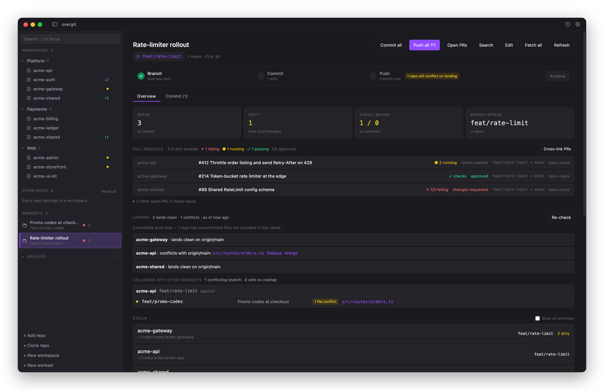
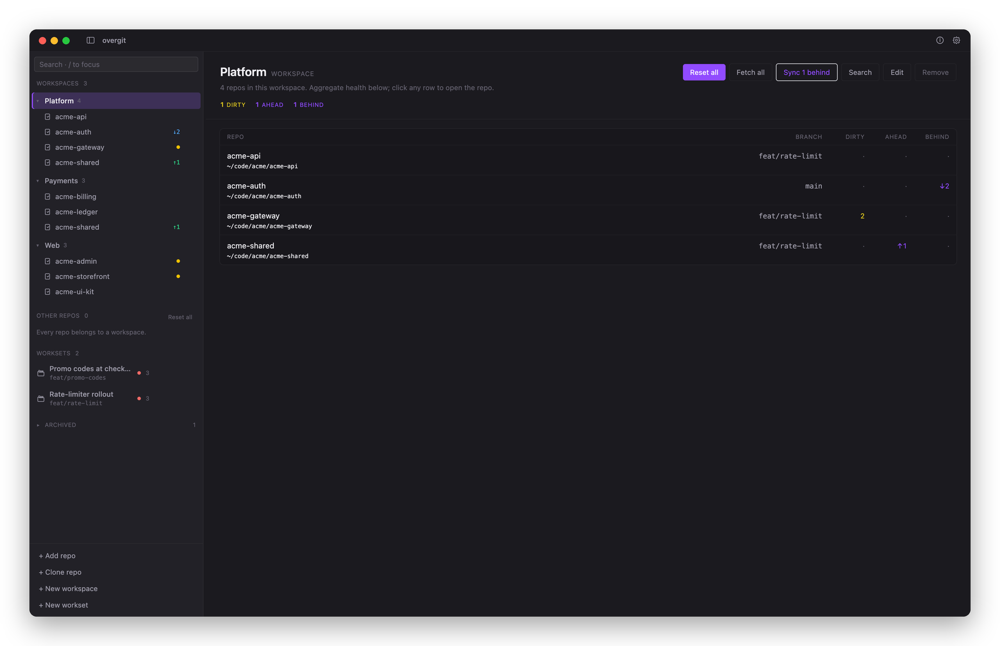
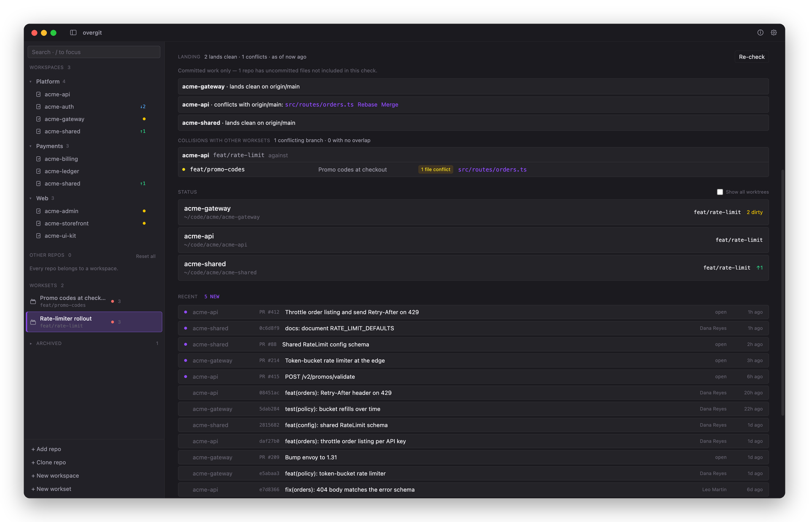
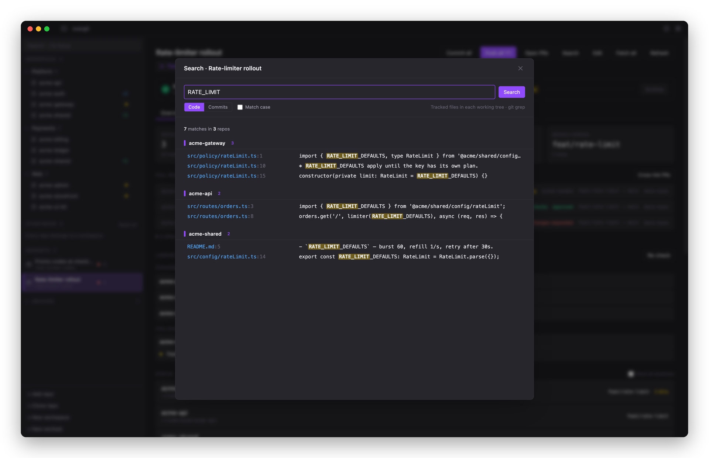
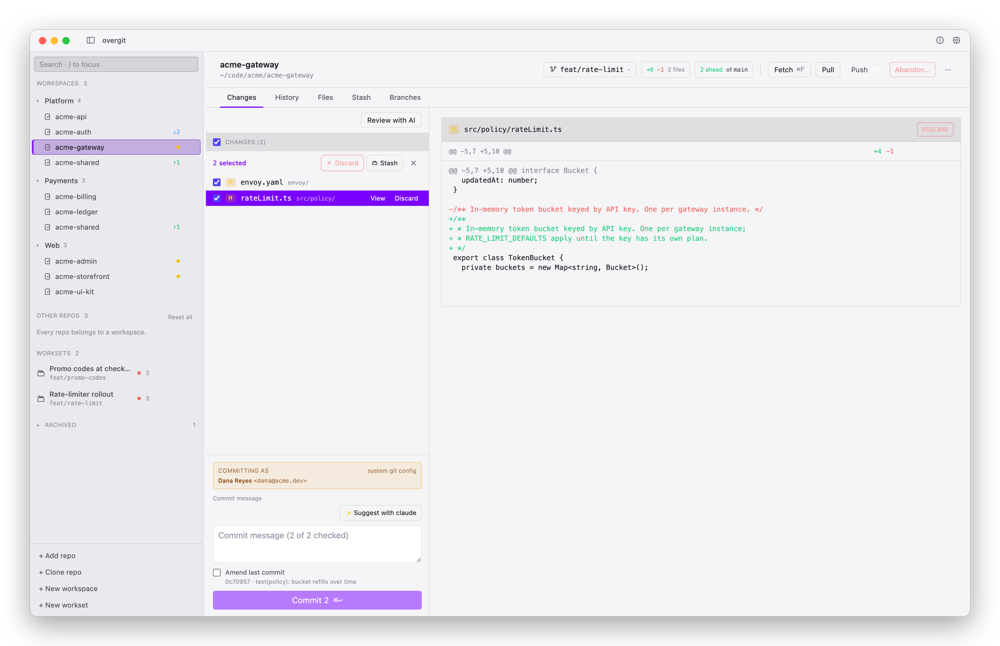
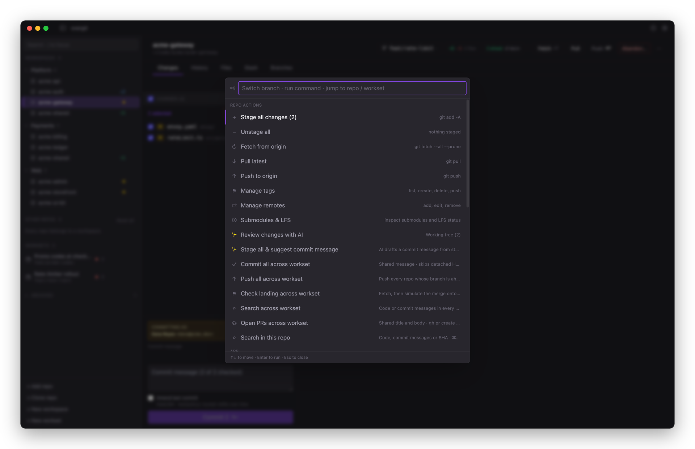

# overgit

A multi-repo git client built around two ideas: **workspaces** (durable groupings of repos) and **worksets** (units of work — tickets — that span some of those repos). Coordinate many repos at once without ever owning their state.

Sibling project of [overcli](https://github.com/overcodelions/overcli).

<p align="center">
  
</p>

## Why overgit

GitHub Desktop, Tower, and Fork are all single-repo-at-a-time. If your work spans services + shared libs + infra, you end up scripting your own "checkout `feature/x` everywhere" flow. overgit fills that gap, runs every action as a plain `git` command in the repo's existing directory, and never writes inside `.git`.

### Workspaces vs. worksets

The two concepts are **orthogonal** — the same repo lives in both at once:

- **Workspace** — a durable, identity-bearing grouping of repos. "These are Platform." "These are Payments." Workspaces are the sidebar's collapsible sections, and they're the target for bulk actions like *fetch all*, *reset all to default*, and "what's the status across this whole group?"
- **Workset** — a transient unit of in-flight work that spans some repos, pinned to a feature branch. Think of a workset as a *ticket you can resume across repos*: "ship the auth migration across `api-gateway`, `billing-svc`, and `ledger-core` this week." Worksets are created when you start work, archived when the work ships, and reset cleanly when you're done with them.

A repo can belong to many workspaces (small shared libs are the common case) and to many worksets at once (the migration ticket and the rate-limit ticket both touch `api-gateway`).

### Three principles

1. **Coordinate.** Branch across the repos a workset spans in one go. See status and dirty state across a whole workspace, and PRs, CI and landing conflicts across a workset, at once.
2. **Overlay, not metadata.** overgit never writes inside `.git`. No manifest, no synthetic root, no hidden file on disk. Stop using it any time and your repos behave the same in any other tool.
3. **AI in the loop.** Pipe a diff to `claude` / `codex` / `gemini` for review. Have an LLM CLI draft your commit message from the staged diff. Uses your existing CLI auth — nothing leaves your machine via overgit.

## Download

Builds for macOS (Apple Silicon and Intel, signed and notarized), Windows and Linux are on the [latest release](https://github.com/overcodelions/overgit/releases/latest). The app updates itself from GitHub Releases. Pick the *stable* or *nightly* channel in Settings.

## Getting started

1. **Open overgit.** With nothing added yet, the welcome screen checks this machine for git (the only requirement) and for the optional CLIs, with an install command for anything missing. It notices a new install on its own; no restart needed.
2. **Add your repos** (⌘O). Pick a repo, or the folder that holds all your checkouts — every repo one level down comes in. Or clone one from a URL, GitHub, GitLab or Bitbucket.
3. **Follow the checklist.** The sidebar's *Getting started* card walks you through your first workspace and your first workset, then gets out of the way.

Help is always one step away: the **Help** menu (How Overgit Works, Setup — Git and CLIs, Keyboard Shortcuts), typing `help` in the command palette (⌘K), or ⌘/ (or `?`) for the shortcut cheat sheet.

## What's in the box

### Workspaces (durable groupings)

<p align="center">
  
</p>

- **Sidebar grouping.** Each workspace is a collapsible section. Repos can appear in many workspaces. Each repo row shows dirty, ahead and behind at a glance, kept honest by a quiet background fetch.
- **Workspace page.** Branch, dirty, ahead and behind for every member in one table.
- **Workspace-wide actions.** *Fetch all*, *Sync N behind* (fast-forwards repos that are only behind, from what's already fetched), and *Reset all to default* (fetch → switch → hard-reset to `origin/<default>` across every member).
- **Smart reset safety.** Any repo with commits not on `origin/<default>` stops and asks before the hard-reset would erase them — per-repo `[force reset (lose N)]` / `[skip]` outcomes, never a silent disaster.

### Worksets (tickets across repos)

The screenshot at the top is a workset: three repos on `feat/rate-limit`, their PRs with CI and review status, and the landing check.

- **A workset is a ticket.** Name it ("rate-limiter rollout"), pick the repos it touches, optionally bind it to a feature branch (`feat/rate-limit`). Resume it any time — the sidebar surfaces active worksets with their branch and a landing dot.
- **Workset-wide branching.** Sync each member repo to its default → pull → branch, all in one workflow (⌘N). Per-repo outcomes if any of them fail.
- **Commit, push and open PRs together.** One commit message across every dirty member, push everything that's ahead, and open a PR per repo (`gh pr create` on GitHub, a prefilled web form on Bitbucket).
- **CI and reviews at a glance.** The workset's own PRs show check status (passing / failing / running) and review state, rolled up in the section header. Other open PRs in the same repos are listed separately.
- **Cross-linked PRs.** One click adds a Related PRs list to every PR in the workset, refreshed in place on re-run.
- **Recent activity.** New commits and PRs across the members since you last looked.
- **Archive when shipped.** Workset done — committed and pushed across all repos? Archive it. It vanishes from the active list into the collapsed "Archived" section. Repos on disk are unchanged. Reactivate any time.
- **Workset reset.** One action fans out fetch → switch back to `origin/<default>` → hard-reset → delete the workset's bound branch across every member. Same safety checks as workspace reset.

### Landing check

<p align="center">
  
</p>

Landing Check continuously answers whether every committed workset branch will land on its default branch, names the conflicted files, and flags collisions between active worksets that share a repo. It refreshes after background fetches and shows conflicts in the sidebar, on the workset page, and in the command palette, with one-click Rebase or Merge.

It uses Git 2.38+ `git merge-tree --write-tree`, which never touches the working tree, index, or refs. Git does write unreachable loose merge objects into `.git/objects`; its normal `gc --auto` collects them, and unchanged SHA pairs are memoized. Uncommitted work is intentionally left out. On older Git versions it reports unsupported and nothing else changes.

### Search across repos

<p align="center">
  
</p>

File contents (`git grep`) or commit messages (or a SHA) across a repo, workset or workspace, grouped by repo, with Match case. Click a code hit to open the file, or a commit to jump to it in History. Open it from the Search button, the command palette, or ⌘⇧F.

### Per-repo and AI

<p align="center">
  
</p>

- **Repo tabs.** Changes / History / Files / Stash / Branches (⌘1–5). Changes has checkboxes and a bulk-action bar (Stage / Stash / Discard). Staging is *simple* by default (the checkboxes decide what's committed); *advanced* brings back separate staged and unstaged lists.
- **History.** A fast list by default, or a per-lane colored branch graph with ref labels. Optional squash-merge detection.
- **Files.** A CodeMirror editor with syntax highlighting for 30+ languages, loaded on first use and sandboxed to registered repos.
- **Branch picker** (⌘B). Searchable popover with local and remote branches, ↑↓/Enter, inline create-branch with optional sync-and-pull, and per-branch cherry-pick (commit-list multi-select). If another worktree holds the branch you want, it offers to detach that worktree and switch.
- **Commit identity.** The commit box always shows who you'll commit as and where that comes from. Set a per-repo override or a global default so a work repo never gets your personal email.
- **Also:** worktrees, tags, remotes, submodules & LFS status, blame and file history, and guided recovery when a pull is blocked by local changes.
- **AI review, suggest and resolve.** Detects `claude` / `codex` / `gemini`. Pipes diffs into the chosen CLI in non-interactive mode (90s cap). Suggest drafts a conventional-commit message from the staged diff and drops it into the commit input. In a merge conflict, it can draft a resolution for you to review.

### Command palette

<p align="center">
  
</p>

⌘K opens a context-aware palette: switch or create branches, jump to repos, workspaces and worksets, open files, and run repo or workset actions (stage all, fetch, pull, push, AI review, "stage all & suggest commit message", check landing, open PRs).

### Everywhere else

- Resizable sidebar, dark / light / system theme, and an interface size setting (⌘+ / ⌘− / ⌘0).
- *Explain mode* shows the `git` command behind each action, for anyone learning git.
- Keyboard shortcuts everywhere.

## Status

Pre-1.0 and building in the open. Expect things to move; see [CHANGELOG.md](./CHANGELOG.md).

## Stack

Electron + React + Tailwind + Vite + Zustand + TypeScript, with CodeMirror 6 for the editor, electron-updater for updates and Vitest for tests. Mirrors overcli's `src/{main,preload,renderer,shared}` layout.

## Run it

Needs Node 20+ (`.nvmrc` pins 22) and git.

```bash
npm install
npm run dev          # Vite dev server on :5273 + Electron
# or
npm start            # build, then run the built app
npm test             # unit tests (Vitest)
npm run typecheck
```

If you want to use overgit on its own source tree, run `npm start` rather than `npm run dev` — Vite HMR otherwise reloads the renderer every time you save a watched file through overgit's editor.

The README screenshots are generated from fictional repos; see [`docs/screenshots/README.md`](docs/screenshots/README.md) to regenerate them.

## Keyboard shortcuts

⌘ on macOS, Ctrl elsewhere. The full list is in the app under Help → Keyboard Shortcuts (⌘/).

| Key | What |
| --- | --- |
| ⌘K | Command palette — branches, repos, files, actions, help |
| ⌘O | Add repositories |
| ⌘, | Settings |
| ⌘\ | Toggle sidebar |
| ⌘R | Refresh the repo or workset you're looking at |
| ⌘⇧F | Search the repo, workset or workspace you're looking at |
| ⌘/ or `?` | Keyboard shortcuts |
| ⌘+ / ⌘− / ⌘0 | Interface size: bigger, smaller, back to 100% |
| ⌘B | Branch picker (in a repo) |
| ⌘N | New branch (in a repo, or across a workset's repos) |
| ⌘⏎ | Commit (in a repo) |
| ⌘P / ⌘F | Push / fetch (in a repo) |
| ⌘1 – 5 | Repo tabs: Changes / History / Files / Stash / Branches |
| ⌘S | Save open file |
| `/` | Search the sidebar |
| ↑↓⏎ | Navigate picker / palette |
| Esc | Close a sheet, picker or the palette |

## CLIs overgit shells out to

- **`git`** — every operation. The whole point. Landing Check needs Git 2.38+ for `merge-tree --write-tree`.
- **`gh`** — workset PRs with CI and review status (`gh pr list`), opening and cross-linking PRs (`gh pr create` / `gh pr edit`), and your GitHub repos in the clone picker (`gh api`).
- **`glab`** — your GitLab projects in the clone picker. Without it, overgit falls back to the GitLab API with the token your git credential helper already holds.
- **`jj`** — detected; integration planned.
- **`claude`** — `claude -p -` for review, commit messages and conflict resolution.
- **`codex`** — `codex exec --skip-git-repo-check -`. Transcript post-processed to keep only the final assistant body.
- **`gemini`** — `gemini -p -`.

Missing CLIs hide the relevant UI; nothing else changes.

> Spawned CLIs inherit your shell environment — that's how their auth works. Anything in your env (e.g. `*_API_KEY`, `GITHUB_TOKEN`) is visible to whichever CLI you invoke. overgit itself never reads or transmits those values.

## Security

See [SECURITY.md](./SECURITY.md) for how to report a vulnerability and what overgit does/doesn't send over the network.

## A father–son project

overgit is a collaboration between **[Lionel Farr](https://github.com/lionelfarr)** and his son **[Owen Farr](https://github.com/owenlfarr)**, sibling to [overcli](https://github.com/overcodelions/overcli). Same setup: an excuse to build something real together — Owen learning how a desktop app holds together end to end (IPC, state, subprocess plumbing, packaging), Lionel getting to teach by doing instead of explaining in the abstract.

## Contributing

Issues, bug reports, and PRs welcome — please open an issue first for anything non-trivial so we can talk about the shape of it.

- [Open an issue](https://github.com/overcodelions/overgit/issues/new) for bugs, features, or questions
- Read [`CONTRIBUTING.md`](./CONTRIBUTING.md) for dev setup and PR expectations
- See [`CODE_OF_CONDUCT.md`](./CODE_OF_CONDUCT.md) before participating
- Found a security bug? Don't file a public issue — see [`SECURITY.md`](./SECURITY.md)

## License

Licensed under the [Apache License, Version 2.0](LICENSE).

The **overgit** name and logo are trademarks and are not covered by that license — forks are welcome under their own name. See [`TRADEMARKS.md`](TRADEMARKS.md).

Copyright © 2026 Lionel Farr and Owen Farr.
